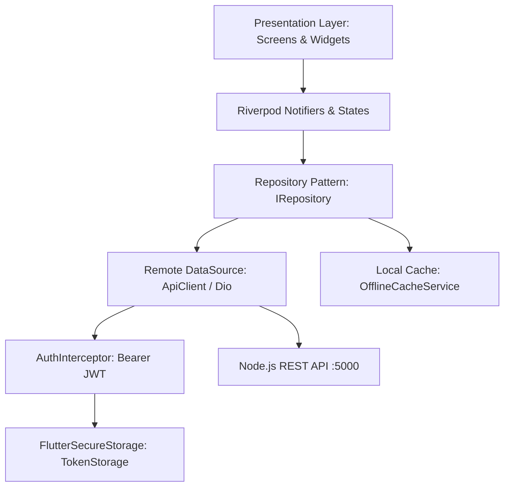

# Probon Mobile App 🚀
### Educational Software Engineering & Capstone Collaboration Platform

[](https://flutter.dev)
[](https://riverpod.dev)
[](https://pub.dev/packages/go_router)
[-06D6A0?logo=checkmarx&logoColor=white)](file:///C:/Projects/Probon%20App/test)
[](https://dart.dev/tools/analysis)
[](https://flutter.dev)
[](file:///C:/Projects/Probon%20App/build/app/outputs/flutter-apk/app-release.apk)

Probon is a production-ready, full-featured native mobile client designed for students, university faculty, and capstone engineering teams. It brings **100% functional parity** with the full-stack web platform (`ProjNaN`), empowering teams to track sprint deliverables, connect GitHub repositories, verify task evidence, chat across project channels, claim weekly arena rewards, and manage class rosters right from mobile devices.

---

## 📑 Table of Contents
- [Key Features](#-key-features)
- [Architecture & Tech Stack](#-architecture--tech-stack)
- [Project Directory Structure](#-project-directory-structure)
- [Prerequisites](#-prerequisites)
- [Backend Server Setup](#-backend-server-setup)
- [Network & API Configuration](#-network--api-configuration)
- [Getting Started & Running](#-getting-started--running)
- [Testing & Quality Assurance](#-testing--quality-assurance)
- [Building the Production APK](#-building-the-production-apk)
- [USB Device Deployment & Testing](#-usb-device-deployment--testing)
- [Default Seed Accounts](#-default-seed-accounts)

---

## ✨ Key Features

### 1. 🛡️ Authentication & Session Persistence
- **Sign In & Registration**: Dual role-based registration (`Student` vs `Teacher`) with optional class code auto-enrollment.
- **Persistent Secure Session**: Built with `FlutterSecureStorage` and JWT token auto-attachment via custom Dio interceptor.
- **Forgot Password & Password Reset**: 
  - Forgot password request with dev token support (`POST /api/auth/forgot-password`).
  - Dedicated `/reset-password` route with token validation, eye visibility toggles, and strict password security rules (`Validators.validatePassword`).
- **Email Verification Banner**: Dismissible banner for unverified accounts with an instant "Resend Link" trigger.

### 2. 📊 Contributor Dashboard & Metric Shell
- **Contributor Stats**: Live overview of Total XP, Contribution Points, Community Rank, Active Projects, and Pending Deliverables.
- **Quick Action Modals**: Direct access to Create Project, Create Task, Create Team, and Join Class.
- **Real-Time Notification Bell**: Unread indicator counter badge updated dynamically across tabs.

### 3. 🎯 Full Project Command Center (`/projects/:id`)
- **Interactive Milestones Timeline**:
  - Live progress meter tracking milestone completion.
  - Interactive milestone completion checkmark awarding team-wide bonus XP (`PUT /api/projects/:id/milestones/:mId`).
  - Sprint Goals checklist and "Add Milestone" modal with date & XP customizer.
- **GitHub Integration Hub**:
  - Connect GitHub repository with URL, default branch, and access token.
  - Live **Sync Button** with animated progress indicator.
  - 3-feed inspector: **Commits** (SHA hash, author, timestamp, commit message), **Pull Requests** (PR status, number, author), and **Issues** (open/closed tickets).
- **Instructor & Peer Evaluations**:
  - 1 to 5 Star rubric rating system with review categories (`Teacher Review`, `Peer Review`).
  - Feedback feed displaying instructor comments and submission timestamps.
- **Team Velocity & Contribution Analytics**:
  - Completion rate gauge with status breakdowns (`Planned`, `In Progress`, `Review`, `Completed`).
  - Total activity events and accumulated XP statistics.
  - Member contribution share progress bars with per-member XP and task counts.
- **Project Settings & Status**:
  - Update project title, description, active status (`Active`, `Completed`, `Archived`), and tech tags.

### 4. 📋 Task Management & Evidence Verification
- **Multi-Scope View**: Instant toggle between *"My Tasks"* and *"All Team Tasks"*.
- **Live Search & Advanced Filtering**:
  - Real-time text search query across title, description, and project name.
  - Status chips (`Planned`, `In Progress`, `Verification Pending`, `Completed`).
  - Priority filter carousel (`Urgent`, `High`, `Medium`, `Low`).
- **Student Evidence Submission**:
  - Submit proof when completing a task (PR link, commit hash, verification notes).
- **Teacher Task Verification**:
  - Instructors review submitted proof and approve or reject tasks with written feedback.
- **Task Deletion**: One-tap delete with safety confirmation.

### 5. 🏫 Class Roster & Team Management (`/classes/:id/roster`)
- **Class Code Sharing**: 6-digit alphanumeric join code with one-tap clipboard copy and toast notification.
- **Enrolled Students Directory**: Inspect student roster with ranks, emails, and XP. Instructors can remove inactive students with confirmation (`DELETE /api/classes/:id/students/:studentId`).
- **Teams & Projects Roster**: View all teams and capstone projects registered under each class with a "+ Add Team" shortcut.

### 6. ⚔️ Weekly Arena & Gamification (`/arena`)
- **Developer Challenges**: Browse weekly challenges with XP rewards, deadlines, and criteria.
- **Accept & Complete Flow**: Claim challenges and submit evidence to unlock XP.
- **Contributor Leaderboard**: Visual podium for top 3 contributors (`🥇`, `🥈`, `🥉`) and rank streak badges.
- **Earned Achievements Showcase**: View unlocked badges (`Bug Hunter`, `Builder`, `Team Player`, `Streak Master`).

### 7. 💬 Team Multi-Channel Chat (`/projects/:id/chat`)
- Project-specific group channels: `#general`, `#announcements`, `#dev`.
- Real-time message timeline with member avatars, timestamps, and active channel indicator.
- Message composer with instant send support.

### 8. 🔔 Notification Center (`/notifications`)
- Dedicated alerts feed for task assignments, verification reviews, and feedback.
- Individual "Mark as Read", item deletion, and bulk "Mark All as Read" actions.

### 9. 🔍 Explore Capstone Projects (`/explore`)
- Search public and course capstone projects across all classes.
- Filter by tech stack tags (`AI`, `Flutter`, `Node.js`, `Cloud`, `Web`).

### 10. ⚡ Offline Mode & Cache Resiliency
- Built with `OfflineCacheService` backed by `SharedPreferences`.
- Automatically caches user projects, tasks, and classes.
- Seamlessly falls back to local cached snapshots when offline or during poor connectivity.

---

## 🏗️ Architecture & Tech Stack



| Layer | Technology | Description |
| :--- | :--- | :--- |
| **Framework** | Flutter 3.13+ (Dart 3.x) | Cross-platform mobile UI framework |
| **State Management** | `flutter_riverpod: ^3.4.3` | Modern Riverpod Notifier architecture |
| **Routing** | `go_router: ^18.1.2` | Declarative routing with auth redirection |
| **Networking** | `dio: ^5.11.1` | REST client with interceptors and timeout policies |
| **Secure Storage** | `flutter_secure_storage: ^11.2.0` | Keystore/KeyChain encrypted JWT storage |
| **Cache Storage** | `shared_preferences: ^2.5.6` | Offline fallback persistence |
| **Icons** | `lucide_icons_flutter: ^4.0.1` | High-clarity SVG iconography (tree-shaken) |
| **Theme** | Custom AMOLED Dark | Tailored palette (`#090A0F`, `#7C3AED`, `#10B981`) |
| **Testing** | `flutter_test`, `mocktail: ^1.0.5` | 129 automated unit and widget tests |

---

## 📁 Project Directory Structure

```text
lib/
├── core/
│   ├── config/              # Base URLs, port configurations, and timeouts
│   ├── network/             # Dio ApiClient, AuthInterceptor, ApiResponse wrapper
│   ├── routing/             # AppRouter definition with GoRouter & route guards
│   ├── storage/             # TokenStorage (Secure) & OfflineCacheService (SharedPrefs)
│   ├── theme/               # Dark theme palette, typography, card styles
│   ├── utils/               # Form validators & AppToast notification helpers
│   └── widgets/             # Reusable shimmer skeletons and common UI
│
├── features/
│   ├── auth/                # Login, Register, Reset Password, Forgot Password Dialog
│   ├── classes/             # Class Roster Screen, Join/Create Class/Team Modals
│   ├── dashboard/           # Main 4-tab shell (Overview, Projects, Tasks, Profile)
│   ├── projects/            # Project Command Center, GitHub Hub, Analytics, Explore
│   ├── tasks/               # Task cards, evidence submission, teacher verification
│   ├── chat/                # Project multi-channel team chat & message composer
│   ├── gamification/        # Weekly Arena, developer challenges, and leaderboard
│   └── notifications/       # In-app notifications center with unread counter
│
└── main.dart                # Application entrypoint with ProviderScope
```

---

## ⚙️ Prerequisites

Before running the application, make sure you have the following installed:

1. **Flutter SDK**: `^3.13.7` or later ([Install Guide](https://docs.flutter.dev/get-started/install))
2. **Dart SDK**: `^3.0.0` (bundled with Flutter)
3. **Node.js**: `v18.0.0` or later (for running the backend server)
4. **Android SDK / Android Studio**: For Android emulator or physical device deployment
5. **Git**: Version control

Verify your Flutter environment by running:
```bash
flutter doctor
```

---

## 🖥️ Backend Server Setup

The mobile application communicates with the Probon Node.js Express backend located in `c:\Projects\Probon\ProjNaN\backend`.

1. Open a terminal and navigate to the backend directory:
   ```bash
   cd "C:\Projects\Probon\ProjNaN\backend"
   ```

2. Install dependencies (if not already installed):
   ```bash
   npm install
   ```

3. Seed the SQLite database with mock classes, projects, tasks, and users:
   ```bash
   npm run db:seed
   ```

4. Start the backend daemon:
   ```bash
   npm run dev
   # or
   npm run start
   ```
   *The server will start listening on `http://localhost:5000`.*

---

## 🌐 Network & API Configuration

The mobile app's API client ([`lib/core/config/api_config.dart`](file:///C:/Projects/Probon%20App/lib/core/config/api_config.dart)) automatically detects your platform and routes requests:

| Environment | Base URL | How to Connect |
| :--- | :--- | :--- |
| **Physical Android Device (USB)** | `http://127.0.0.1:5000/api` | Run `adb reverse tcp:5000 tcp:5000` (Recommended) |
| **Android Emulator** | `http://10.0.2.2:5000/api` | Pass `--dart-define=API_URL=http://10.0.2.2:5000/api` |
| **Physical Device (Wi-Fi LAN)** | `http://<YOUR_PC_IP>:5000/api` | Pass `--dart-define=API_URL=http://<YOUR_PC_IP>:5000/api` |
| **Windows Desktop / Web** | `http://localhost:5000/api` | Default out-of-the-box |

---

## 🚀 Getting Started & Running

1. Open a terminal and navigate to the Flutter project:
   ```bash
   cd "C:\Projects\Probon App"
   ```

2. Fetch Flutter package dependencies:
   ```bash
   flutter pub get
   ```

3. Run static analysis to verify codebase integrity:
   ```bash
   flutter analyze
   ```

4. Launch the application:
   - **On connected USB Device**:
     ```bash
     adb reverse tcp:5000 tcp:5000
     flutter run
     ```
   - **On Android Emulator**:
     ```bash
     flutter run --dart-define=API_URL=http://10.0.2.2:5000/api
     ```
   - **On Windows Desktop**:
     ```bash
     flutter run -d windows
     ```

---

## 🧪 Testing & Quality Assurance

The codebase includes **129 passing automated unit and widget tests** covering authentication, offline caching, task verification, project command centers, chat feeds, weekly arena challenges, and class rosters.

### Running Tests
Execute the entire test suite:
```bash
flutter test
```

### Automated Phase Verification Scripts
You can run the end-to-end analyzer + test suite verification script in one step:

- **PowerShell**:
  ```powershell
  .\test_phase13.ps1
  ```
- **Windows Command Prompt**:
  ```cmd
  test_phase13.bat
  ```

---

## 📦 Building the Production APK

To assemble a fully optimized, tree-shaken, AOT-compiled release APK for Android:

```bash
flutter build apk --release
```

The resulting release APK will be located at:
```text
build\app\outputs\flutter-apk\app-release.apk
```
*Current release size: ~56 MB with 97%+ icon tree-shaking applied.*

---

## 📱 USB Device Deployment & Testing

To install and test the release build directly on an Android smartphone connected via USB:

1. **Enable Developer Options & USB Debugging** on your Android phone.
2. Connect your phone via USB cable and ensure it is detected:
   ```bash
   adb devices
   ```
3. Forward the local backend port to your device:
   ```bash
   adb reverse tcp:5000 tcp:5000
   ```
4. Install the release APK directly to your phone:
   ```bash
   adb install -r "build\app\outputs\flutter-apk\app-release.apk"
   ```

---

## 👥 Default Seed Accounts

You can immediately log in using pre-seeded accounts created by `npm run db:seed`:

| Role | Email Address | Password | Permissions |
| :--- | :--- | :--- | :--- |
| **Teacher / Instructor** | `instructor@probon.edu` | `Password123!` | Create classes, verify deliverables, post evaluations, remove students |
| **Student (Aryan)** | `aryan@probon.edu` | `Password123!` | Submit task evidence, accept challenges, connect GitHub repos, chat |
| **Student (Elena)** | `elena@probon.edu` | `Password123!` | Collaborate on capstone milestones, review team activities |

---

## 📄 License
This project is developed for educational software engineering, capstone management, and student team collaboration. Distributed under the MIT License.
